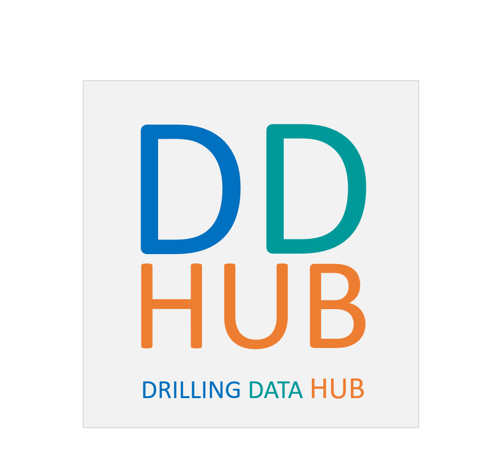

# DDHub Semantic Interoperability
Work Package 1 (DSID): ontology, vocabulary, and examples for DDHub semantic interoperability across drilling data.

## Contents
- `model/` - DDHub ontology in multiple serializations (XML, Turtle, JSON, Manchester, RTF) with generated HTML docs (`model/html/documentation`).
- `examples/` - OWL examples for common signals and circuits (flow-rate, hookload, torque, ECD, hydraulic/mechanical circuits, LWD, HIL demo, manifests).
- `docs/` - narrative docs for the semantic model, use cases, drilling signal descriptions, architecture draft, and vocabulary development notes.
- `src/DWIS-Vocabulary/` - .NET solution `DWIS.Vocabulary.sln` containing vocabulary/schema tooling, instance editors, standard sets, controls, utilities, tests, and local NuGet packages for offline builds.

## Quick start
- Explore the model: open `model/DDHub_xml.owl` (or Turtle/JSON) in your OWL tool of choice; HTML docs live at `model/html/documentation/index-en.html`.
- See example patterns: browse `examples/` for OWL instances of signals and circuits.
- Build vocabulary tools: `dotnet build src/DWIS-Vocabulary/DWIS-Vocabulary.sln` (use `LocalPackages/` if offline).
- Read background: `docs/DDHub_semantic_model.md`, `docs/use_cases/Use_cases.md`, `docs/drilling_signals/home.md`, `docs/architecture/DDHub_architecture.md`.

## Downhole instrument identity and sensing

The vocabulary definition sources under `docs/vocabulary_development/definitions`
now distinguish instrument models, physical units, sensors, measurement principles
and deployed telemetry capability. See
[the six-tool example](docs/vocabulary_development/examples-new/DownholeInstrumentIdentityAndTelemetry.md)
for BlackStream EMS/ASM, BaseStar, 4D Caliper, DrillView and FracView, including
BaseStar's separate wired-pipe and MWD mud-pulse streams. General sensing principles
are in `MeasurementPrinciples.md`; flow-specific principles remain in `Hydraulics.md`.
Instrument identity is in `InstrumentIdentity.md`, separate from the spreadsheet-generated
`DrillingEquipment.md` taxonomy.
Structured measurement aggregates use `MeasurementCollection` and
`AlongStringMeasurementCollection`. General JSON values expose inherited `SchemaURL`
and `MetaDataURL` attributes so consumers can validate the payload and resolve the
field-level semantic description. See the
[BaseStar collection example](docs/vocabulary_development/examples-new/BaseStarAlongStringMeasurementCollections.md)
for multiple tools and separate mud-pulse and wired-pipe collections.
The source definitions, generated vocabulary and C# schemas are checked in together. Review the
example's ancestry compatibility notes before regenerating downstream artifacts.


## Regeneration and verification

`DWISVocabularyDevelopment.Actions` is the generation entry point. It rebuilds the
equipment definitions from `DrillingEquipment.xlsx`, regenerates quantity definitions,
and writes the combined/individual Markdown, JSON, ontology exports, embedded Standard
resource and C# schemas. It uses invariant culture for reproducible numeric text.
For a local run, build the Actions project and execute its DLL from a working folder
containing `appsettings.json` with an `ActionsConfig` section. Set `SourceFolder`,
`DestinationFolder`, `SchemaFolder`, `ExamplesSourceFolder` and `StandardResourceFolder`
to this checkout's corresponding paths (see the workflow); set `ProjectsToPack` to
an empty string and `IncrementVersion` to false. Keep that local configuration out
of the repository. Generation failure returns a nonzero exit code.

Verify source/generated JSON agreement, local compiled C# schemas and the six-tool
examples with:

```powershell
dotnet run --project src/DWIS-Vocabulary/DWIS-Vocabulary/VocabularyParseTest/DWIS.Vocabulary.Parse.Test.csproj
```

An explicit repository path may be supplied after `--`. This command extracts and
parses the `dwis` fenced example bodies because the legacy instance Markdown reader
skips fenced blocks. It does not depend on a previously published vocabulary package.

The vocabulary-generation workflow runs verification before committing generated
files and publishing packages. NuGet authentication uses `NuGet/login@v1`, GitHub OIDC
(`id-token: write`) and the repository secret `NUGET_USER`. Configure the NuGet.org
Trusted Publishing policy for this repository and `vocabulary-generation.yml`, plus
any environment restriction configured there. The username is the NuGet profile name,
not an email address. No long-lived NuGet API-key secret is used. The generated-file
commit grants `contents: write` and skips committing when there are no changes.

## WordPress glossary publication

The glossary workflow publishes complete noun and verb descriptions from generated JSON,
updates only changed content, and verifies every source entry by reading the site back.
See [publisher setup and verification](docs/vocabulary_development/scripts/README.md).
Concurrent glossary runs are serialized; failed writes and mismatches fail the workflow.
Existing glossary URLs and unrelated entries are retained.

## Active rig-job context

ContextualData now defines RigJobDescription under WellBoreData, with IsRigJobForWellBore and IsRigJobOnRig relationships. Current identifies the active context; the OSDC JSON contract retains job dates, identifiers, depth ownership and canonical WGS84 depth. RigDescription remains the rig equipment description. Regenerate and verify all outputs together, then follow the dependency-ordered release runbook in Semantic-Server-Deploy/Documentation/RigJob-vocabulary-release.md, including OSDC DrillingProperties and both deploy workflows.
