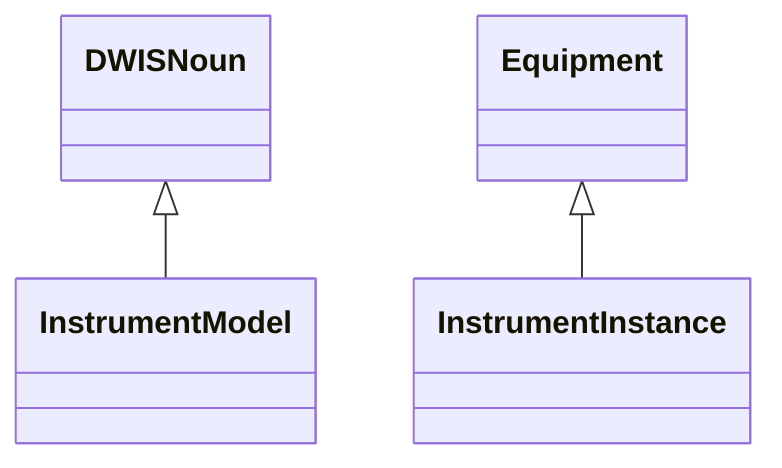
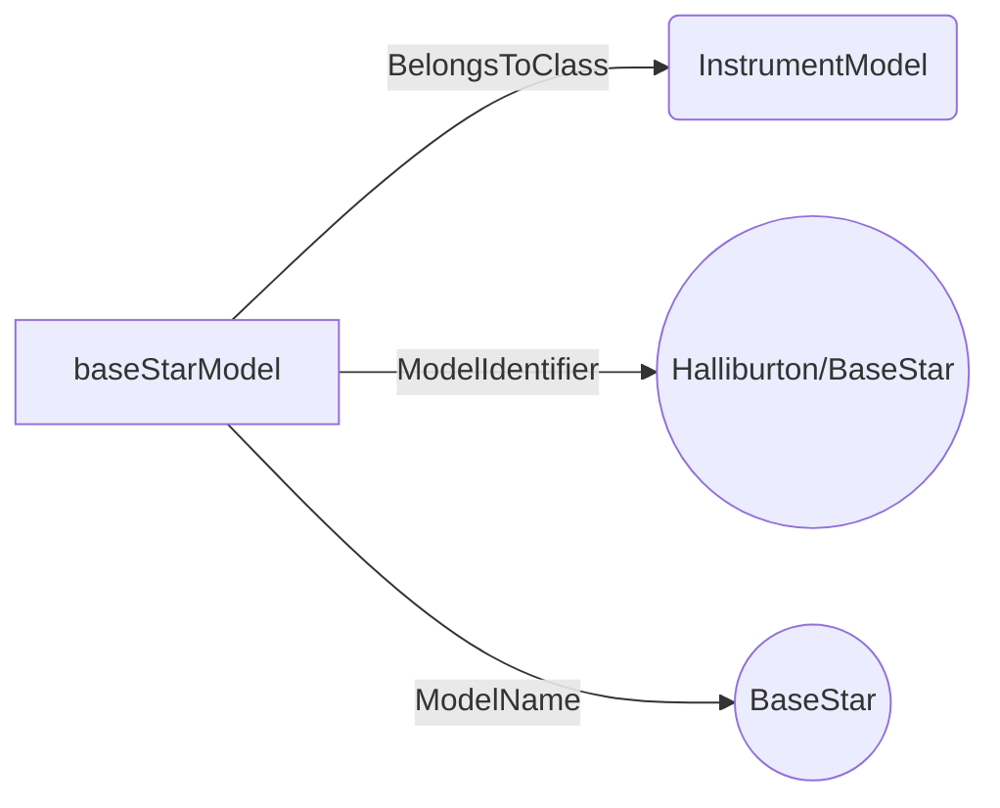
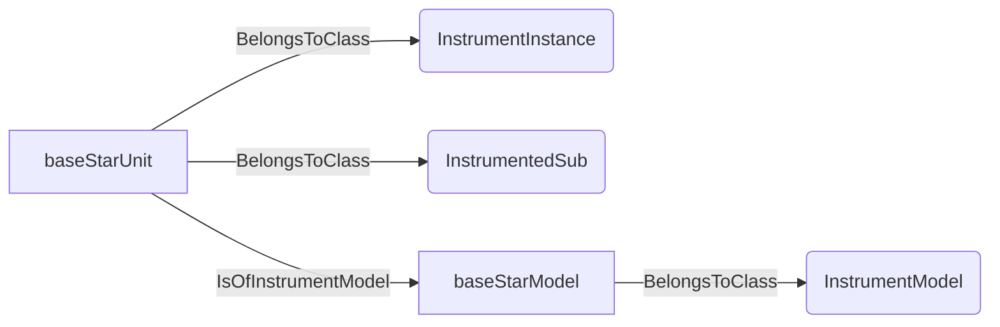
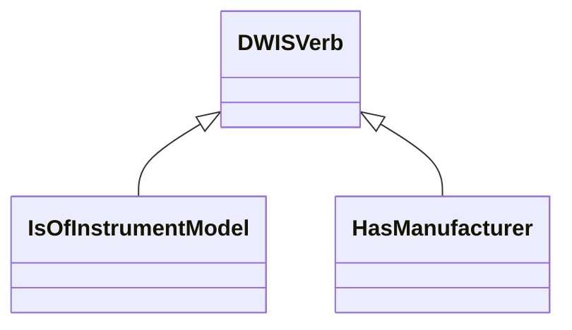
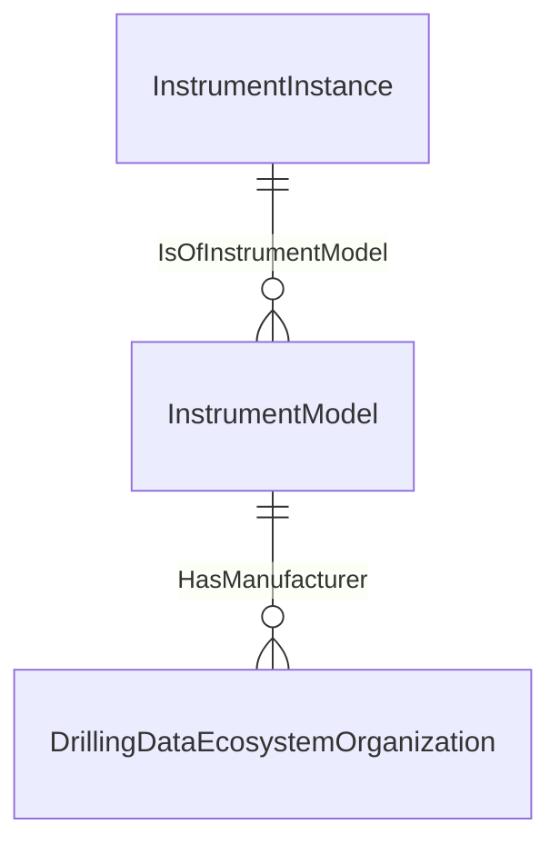
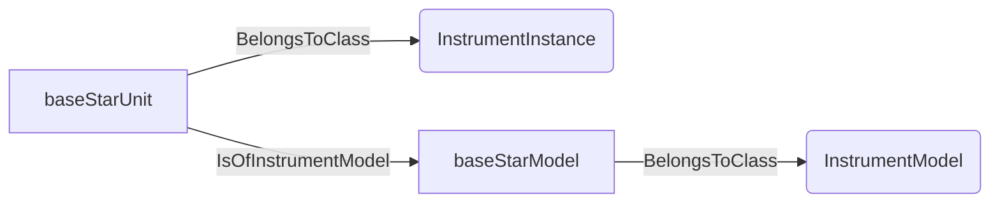
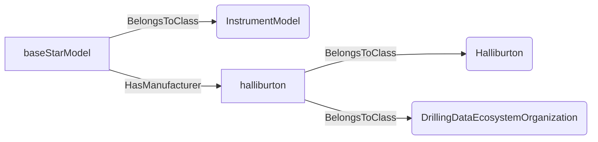

# InstrumentIdentity<!-- DEFINITION SET HEADER -->
- Description: 
Product-model identity, physical instrument instances and manufacturer relationships. Equipment taxonomy remains in DrillingEquipment; sensor ownership is in DataFlow.

# Nouns
## Class Inheritance for Nouns
Here is a class inheritance diagram for the nouns contained in this definition set.

## InstrumentModel <!-- NOUN -->
- Display name: InstrumentModel
- Parent class: [DWISNoun](./DWISSemantics.md#DWISNoun)
- Attributes:
  - ModelIdentifier
    - Type: string
    - Description: Stable manufacturer-qualified product/model identifier, governed by the model catalog.
  - ModelName
    - Type: string
    - Description: Human-readable product/model name.
- Description: 
A manufacturer-defined instrument product or model, independent of individual physical units. Model variants with materially different specifications use distinct model nodes. Model identifiers are catalog data, not vocabulary class names.
- Definition set: InstrumentIdentity
- Examples:
```dwis InstrumentModelExample
InstrumentModel:baseStarModel
baseStarModel.ModelIdentifier = "Halliburton/BaseStar"
baseStarModel.ModelName = "BaseStar"
```
An example semantic graph looks like as follow:

An example SparQL query looks like this:
```sparql
PREFIX rdf: <http://www.w3.org/1999/02/22-rdf-syntax-ns#>
PREFIX ddhub: <http://ddhub.no/>
PREFIX quantity: <http://ddhub.no/UnitAndQuantity>
SELECT ?InstrumentModelExample
WHERE {
	?baseStarModel rdf:type ddhub:InstrumentModel .
	?baseStarModel ddhub:ModelIdentifier ?Attribute000 .
	?baseStarModel ddhub:ModelName ?Attribute001 .
  FILTER (
	?Attribute000 = "Halliburton/BaseStar"
	&& 	?Attribute001 = "BaseStar"
  )
}
```
## InstrumentInstance <!-- NOUN -->
- Display name: InstrumentInstance
- Parent class: [Equipment](./DrillingEquipment.md#Equipment)
- Attributes:
  - SerialNumber
    - Type: string
    - Description: Optional manufacturer-assigned serial number of this physical unit.
  - AssetIdentifier
    - Type: string
    - Description: Optional externally managed asset identifier; its issuing authority is supplied by the deployment catalog.
- Description: 
An identifiable physical instrument assembly. Its graph URI is the primary identity; optional serial numbers and asset identifiers are not globally unique by themselves. An instance may also be classified using an appropriate existing equipment class, such as InstrumentedSub.
- Definition set: InstrumentIdentity
- Examples:
```dwis InstrumentInstanceExample
InstrumentInstance:baseStarUnit
baseStarUnit BelongsToClass InstrumentedSub
InstrumentModel:baseStarModel
baseStarUnit IsOfInstrumentModel baseStarModel
```
An example semantic graph looks like as follow:

An example SparQL query looks like this:
```sparql
PREFIX rdf: <http://www.w3.org/1999/02/22-rdf-syntax-ns#>
PREFIX ddhub: <http://ddhub.no/>
PREFIX quantity: <http://ddhub.no/UnitAndQuantity>
SELECT ?InstrumentInstanceExample
WHERE {
	?baseStarUnit rdf:type ddhub:InstrumentInstance .
	?baseStarUnit rdf:type ddhub:InstrumentedSub .
	?baseStarModel rdf:type ddhub:InstrumentModel .
	?baseStarUnit ddhub:IsOfInstrumentModel ?baseStarModel .
}
```
# Verbs
## Class Inheritance for Verbs
Here is a class inheritance diagram for the verbs contained in this definition set.

## Relations
Here is a graph representing the relations that can be made with the verbs defined in this definition set.

## IsOfInstrumentModel <!-- VERB -->
- Display name: IsOfInstrumentModel
- Parent verb: [DWISVerb](./DWISSemantics.md#DWISVerb)
- Subject class: [InstrumentInstance](./InstrumentIdentity.md#InstrumentInstance)
- Object class: [InstrumentModel](./InstrumentIdentity.md#InstrumentModel)
- Definition set: InstrumentIdentity
- Description: 
Associates a physical instrument with its manufacturer-defined model. Assign one model at the chosen assembly granularity; replace an assignment explicitly when correcting catalog data.
- Examples:
```dwis IsOfInstrumentModelExample
InstrumentInstance:baseStarUnit
InstrumentModel:baseStarModel
baseStarUnit IsOfInstrumentModel baseStarModel
```
An example semantic graph looks like as follow:

An example SparQL query looks like this:
```sparql
PREFIX rdf: <http://www.w3.org/1999/02/22-rdf-syntax-ns#>
PREFIX ddhub: <http://ddhub.no/>
PREFIX quantity: <http://ddhub.no/UnitAndQuantity>
SELECT ?IsOfInstrumentModelExample
WHERE {
	?baseStarUnit rdf:type ddhub:InstrumentInstance .
	?baseStarModel rdf:type ddhub:InstrumentModel .
	?baseStarUnit ddhub:IsOfInstrumentModel ?baseStarModel .
}
```
## HasManufacturer <!-- VERB -->
- Display name: HasManufacturer
- Parent verb: [DWISVerb](./DWISSemantics.md#DWISVerb)
- Subject class: [InstrumentModel](./InstrumentIdentity.md#InstrumentModel)
- Object class: [DrillingDataEcosystemOrganization](./Organizations.md#DrillingDataEcosystemOrganization)
- Definition set: InstrumentIdentity
- Description: 
Identifies the manufacturer of an instrument model. This is distinct from IsProvidedBy, which identifies the provider of data; a data aggregator need not be the manufacturer.
- Examples:
```dwis HasManufacturerExample
InstrumentModel:baseStarModel
Halliburton:halliburton
halliburton BelongsToClass DrillingDataEcosystemOrganization
baseStarModel HasManufacturer halliburton
```
An example semantic graph looks like as follow:

An example SparQL query looks like this:
```sparql
PREFIX rdf: <http://www.w3.org/1999/02/22-rdf-syntax-ns#>
PREFIX ddhub: <http://ddhub.no/>
PREFIX quantity: <http://ddhub.no/UnitAndQuantity>
SELECT ?HasManufacturerExample
WHERE {
	?baseStarModel rdf:type ddhub:InstrumentModel .
	?halliburton rdf:type ddhub:Halliburton .
	?halliburton rdf:type ddhub:DrillingDataEcosystemOrganization .
	?baseStarModel ddhub:HasManufacturer ?halliburton .
}
```
