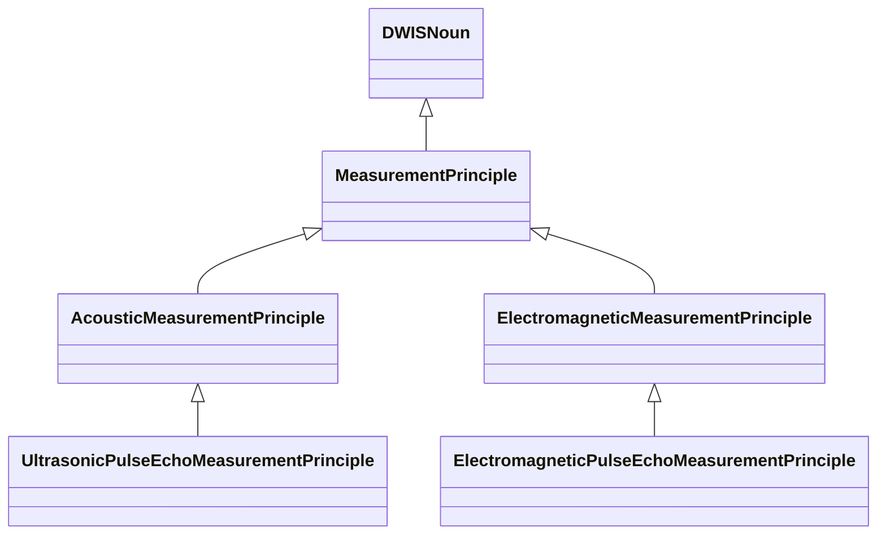
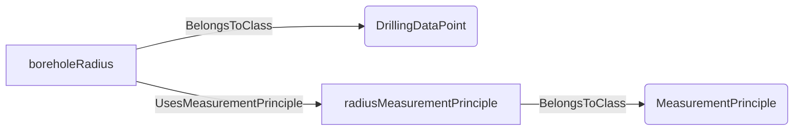
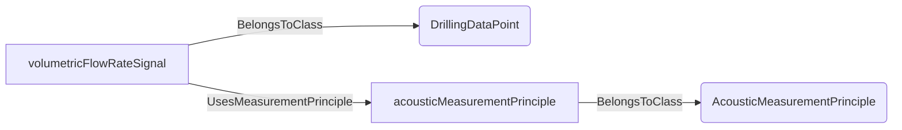
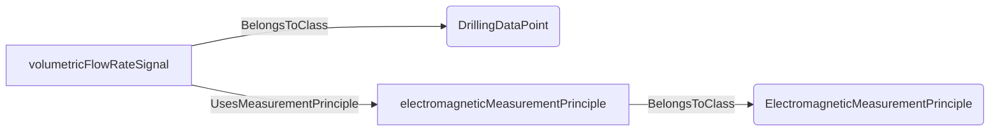
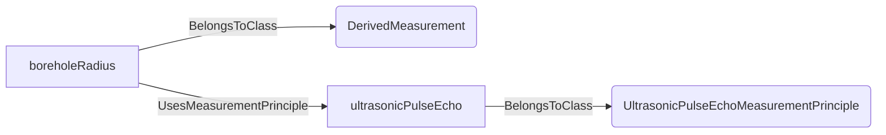
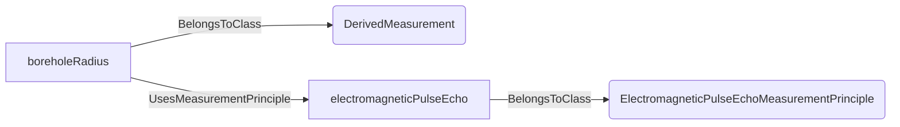
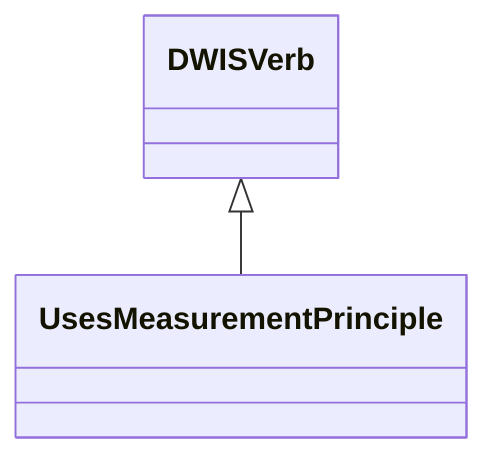
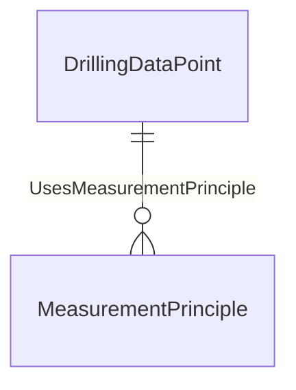

# MeasurementPrinciples<!-- DEFINITION SET HEADER -->
- Description: 
Physical principles used to acquire measurements, independent of instrument identity, signal processing and data telemetry. Flow-specific principles remain in Hydraulics.

# Nouns
## Class Inheritance for Nouns
Here is a class inheritance diagram for the nouns contained in this definition set.

## MeasurementPrinciple <!-- NOUN -->
- Display name: MeasurementPrinciple
- Parent class: [DWISNoun](./DWISSemantics.md#DWISNoun)
- Description: 
The physical mechanism used to obtain a measurement. It describes sensing, not transport, aggregation or the commercial instrument model.
- Definition set: MeasurementPrinciples
- Examples:
```dwis MeasurementPrincipleExample
DrillingDataPoint:boreholeRadius
MeasurementPrinciple:radiusMeasurementPrinciple
boreholeRadius UsesMeasurementPrinciple radiusMeasurementPrinciple
```
An example semantic graph looks like as follow:

An example SparQL query looks like this:
```sparql
PREFIX rdf: <http://www.w3.org/1999/02/22-rdf-syntax-ns#>
PREFIX ddhub: <http://ddhub.no/>
PREFIX quantity: <http://ddhub.no/UnitAndQuantity>
SELECT ?MeasurementPrincipleExample
WHERE {
	?boreholeRadius rdf:type ddhub:DrillingDataPoint .
	?radiusMeasurementPrinciple rdf:type ddhub:MeasurementPrinciple .
	?boreholeRadius ddhub:UsesMeasurementPrinciple ?radiusMeasurementPrinciple .
}
```
## AcousticMeasurementPrinciple <!-- NOUN -->
- Display name: Acoustic Measurement Principle
- Parent class: [MeasurementPrinciple](./MeasurementPrinciples.md#MeasurementPrinciple)
- Description: 
Describes that an acoustic measurement principle is used to perform a measurement.
- Definition set: MeasurementPrinciples
- Examples:
```dwis AcousticMeasurementPrincipleExample
DrillingDataPoint:volumetricFlowRateSignal
AcousticMeasurementPrinciple:acousticMeasurementPrinciple
volumetricFlowRateSignal UsesMeasurementPrinciple acousticMeasurementPrinciple
```
An example semantic graph looks like as follow:

An example SparQL query looks like this:
```sparql
PREFIX rdf: <http://www.w3.org/1999/02/22-rdf-syntax-ns#>
PREFIX ddhub: <http://ddhub.no/>
PREFIX quantity: <http://ddhub.no/UnitAndQuantity>
SELECT ?AcousticMeasurementPrincipleExample
WHERE {
	?volumetricFlowRateSignal rdf:type ddhub:DrillingDataPoint .
	?acousticMeasurementPrinciple rdf:type ddhub:AcousticMeasurementPrinciple .
	?volumetricFlowRateSignal ddhub:UsesMeasurementPrinciple ?acousticMeasurementPrinciple .
}
```
This example states that a volumetric flowrate signal uses an acoustic measurement principle.
## ElectromagneticMeasurementPrinciple <!-- NOUN -->
- Display name: Electromagnetic Measurement Principle
- Parent class: [MeasurementPrinciple](./MeasurementPrinciples.md#MeasurementPrinciple)
- Description: 
Describes that an electromagnetic measurement principle is used to perform a measurement.
- Definition set: MeasurementPrinciples
- Examples:
```dwis ElectromagneticMeasurementPrincipleExample
DrillingDataPoint:volumetricFlowRateSignal
ElectromagneticMeasurementPrinciple:electromagneticMeasurementPrinciple
volumetricFlowRateSignal UsesMeasurementPrinciple electromagneticMeasurementPrinciple
```
An example semantic graph looks like as follow:

An example SparQL query looks like this:
```sparql
PREFIX rdf: <http://www.w3.org/1999/02/22-rdf-syntax-ns#>
PREFIX ddhub: <http://ddhub.no/>
PREFIX quantity: <http://ddhub.no/UnitAndQuantity>
SELECT ?ElectromagneticMeasurementPrincipleExample
WHERE {
	?volumetricFlowRateSignal rdf:type ddhub:DrillingDataPoint .
	?electromagneticMeasurementPrinciple rdf:type ddhub:ElectromagneticMeasurementPrinciple .
	?volumetricFlowRateSignal ddhub:UsesMeasurementPrinciple ?electromagneticMeasurementPrinciple .
}
```
This example states that a volumetric flowrate signal uses an electromagnetic measurement principle.
## UltrasonicPulseEchoMeasurementPrinciple <!-- NOUN -->
- Display name: UltrasonicPulseEchoMeasurementPrinciple
- Parent class: [AcousticMeasurementPrinciple](./MeasurementPrinciples.md#AcousticMeasurementPrinciple)
- Description: 
An ultrasonic pulse is emitted and its returning echo is measured. Travel time can support distance/radius estimation, while echo amplitude provides reflection information; radius and amplitude are separate outputs. This does not describe acoustic telemetry.
- Definition set: MeasurementPrinciples
- Examples:
```dwis UltrasonicPulseEchoMeasurementPrincipleExample
DerivedMeasurement:boreholeRadius
UltrasonicPulseEchoMeasurementPrinciple:ultrasonicPulseEcho
boreholeRadius UsesMeasurementPrinciple ultrasonicPulseEcho
```
An example semantic graph looks like as follow:

An example SparQL query looks like this:
```sparql
PREFIX rdf: <http://www.w3.org/1999/02/22-rdf-syntax-ns#>
PREFIX ddhub: <http://ddhub.no/>
PREFIX quantity: <http://ddhub.no/UnitAndQuantity>
SELECT ?UltrasonicPulseEchoMeasurementPrincipleExample
WHERE {
	?boreholeRadius rdf:type ddhub:DerivedMeasurement .
	?ultrasonicPulseEcho rdf:type ddhub:UltrasonicPulseEchoMeasurementPrinciple .
	?boreholeRadius ddhub:UsesMeasurementPrinciple ?ultrasonicPulseEcho .
}
```
## ElectromagneticPulseEchoMeasurementPrinciple <!-- NOUN -->
- Display name: ElectromagneticPulseEchoMeasurementPrinciple
- Parent class: [ElectromagneticMeasurementPrinciple](./MeasurementPrinciples.md#ElectromagneticMeasurementPrinciple)
- Description: 
An electromagnetic pulse is emitted and its returning response is measured. Time-of-flight and echo amplitude support distinct geometric and reflection outputs. This does not describe electromagnetic telemetry or wired-pipe coupling.
- Definition set: MeasurementPrinciples
- Examples:
```dwis ElectromagneticPulseEchoMeasurementPrincipleExample
DerivedMeasurement:boreholeRadius
ElectromagneticPulseEchoMeasurementPrinciple:electromagneticPulseEcho
boreholeRadius UsesMeasurementPrinciple electromagneticPulseEcho
```
An example semantic graph looks like as follow:

An example SparQL query looks like this:
```sparql
PREFIX rdf: <http://www.w3.org/1999/02/22-rdf-syntax-ns#>
PREFIX ddhub: <http://ddhub.no/>
PREFIX quantity: <http://ddhub.no/UnitAndQuantity>
SELECT ?ElectromagneticPulseEchoMeasurementPrincipleExample
WHERE {
	?boreholeRadius rdf:type ddhub:DerivedMeasurement .
	?electromagneticPulseEcho rdf:type ddhub:ElectromagneticPulseEchoMeasurementPrinciple .
	?boreholeRadius ddhub:UsesMeasurementPrinciple ?electromagneticPulseEcho .
}
```
# Verbs
## Class Inheritance for Verbs
Here is a class inheritance diagram for the verbs contained in this definition set.

## Relations
Here is a graph representing the relations that can be made with the verbs defined in this definition set.

## UsesMeasurementPrinciple <!-- VERB -->
- Display name: UsesMeasurementPrinciple
- Parent verb: [DWISVerb](./DWISSemantics.md#DWISVerb)
- Subject class: [DrillingDataPoint](./DrillingDataSemantics.md#DrillingDataPoint)
- Object class: [MeasurementPrinciple](./MeasurementPrinciples.md#MeasurementPrinciple)
- Definition set: MeasurementPrinciples
- Description: 
Associates a measurement data point with the physical principle by which it is obtained. Retain processing lineage separately and use IsTransmittedBy for transport.
- Examples:
```dwis UsesMeasurementPrincipleExample
DerivedMeasurement:boreholeRadius
UltrasonicPulseEchoMeasurementPrinciple:ultrasonicPulseEcho
boreholeRadius UsesMeasurementPrinciple ultrasonicPulseEcho
```
An example semantic graph looks like as follow:

An example SparQL query looks like this:
```sparql
PREFIX rdf: <http://www.w3.org/1999/02/22-rdf-syntax-ns#>
PREFIX ddhub: <http://ddhub.no/>
PREFIX quantity: <http://ddhub.no/UnitAndQuantity>
SELECT ?UsesMeasurementPrincipleExample
WHERE {
	?boreholeRadius rdf:type ddhub:DerivedMeasurement .
	?ultrasonicPulseEcho rdf:type ddhub:UltrasonicPulseEchoMeasurementPrinciple .
	?boreholeRadius ddhub:UsesMeasurementPrinciple ?ultrasonicPulseEcho .
}
```
